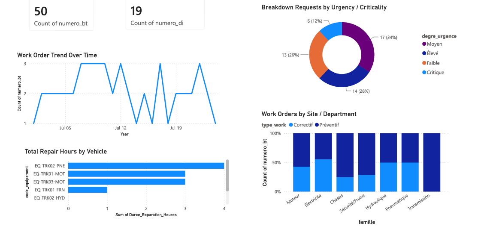
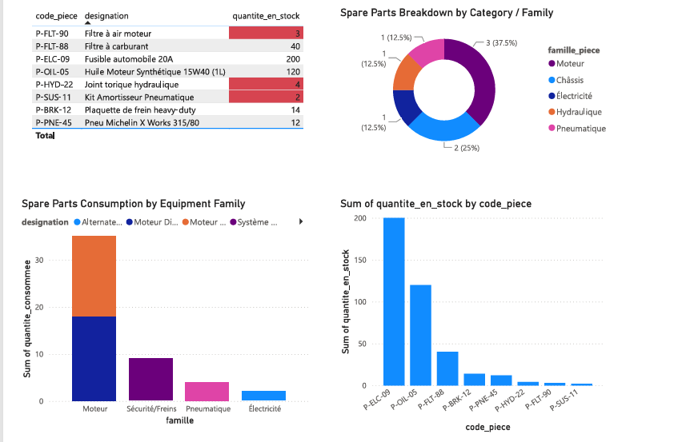
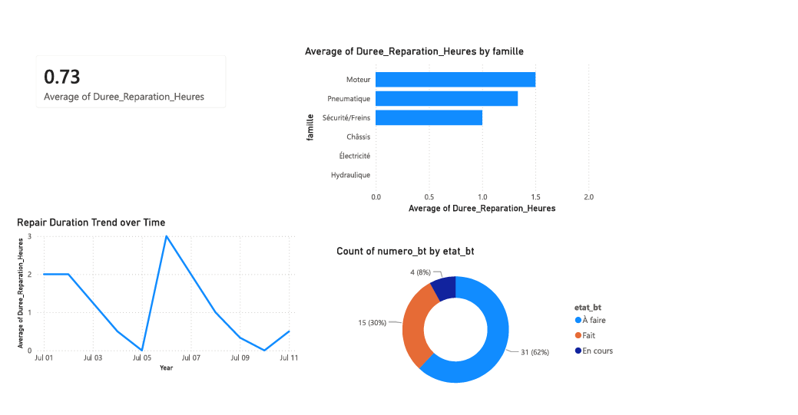
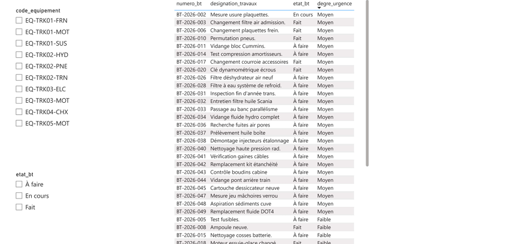

# GMAO-Project
## 📊 Power BI Executive Dashboard Preview

### 1. Executive Fleet Overview & Breakdown Trends

---

### 2. Spare Parts & Warehouse Inventory Matrix

---

### 3. Repair Efficiency KPIs & Work Order Status

---

### 4. Work Order Task & Urgency Detail Log

# 🚛 GMAO Project: Fleet Maintenance & BI Analytics

##  Project Overview
The **GMAO System (Gestion de Maintenance Assistée par Ordinateur)** manages and tracks end-to-end truck maintenance operations, covering intervention requests, scheduled maintenance, work orders, spare parts consumption, and maintenance closure.

###  Operational Workflow
`Demande d'Intervention (DI) / Intervention Planifiée (IP)` ➔ `Bons de Travail (BT)` ➔ `Execution` ➔ `Parts Consumption` ➔ `Closure`

---

##  Key Objectives

### 1. Database Engineering
* Designed and deployed a robust **relational SQL database** to aggregate all fleet maintenance, work orders, and inventory data.
* Structured the database architecture to support real-time data synchronization.

### 2. Business Intelligence (Power BI Dashboard)
Engineered an **interactive 4-page Power BI executive dashboard** focused on:
* **Current-State Analysis:** Evaluated historical maintenance data to identify fleet breakdown trends and failure patterns.
* **Predictive Estimation:** Monitored warehouse consumption to forecast spare parts inventory and stock requirements.
* **Operational Optimization:** Enhanced workshop efficiency, technician utilization rates, and fleet response times.

---

## 🛠️ Tech Stack
* **Database:** SQL (MySQL / Relational DB)
* **Analytics & Visualization:** Power BI (DAX, Data Modeling, 4-page Dashboard)
* **ETL & Data Cleaning:** Power Query / SQL Queries

## 💡 Key Insights & Business Recommendations

###  1. Operations & Fleet Breakdown Trends
* **Work Order Volatility:** Daily demand ranges from 1 to 3 work orders, peaking in early-to-mid July.
  * **Recommendation:** Align workshop staffing with peak days and schedule routine *Interventions Planifiées (IP)* during low-volume days (1 WO/day) to prevent workload bottlenecks.
* **Component Downtime Drivers:** Pneumatic (`EQ-TRK02-PNE` with 4 repair hours) and Engine systems (`TRK01` & `TRK03` with 3 hours each) dominate total downtime.
  * **Recommendation:** Perform immediate targeted overhauls on `TRK02` pneumatic components and conduct root-cause diagnostics on engine units.
* **Failure Analysis by Family:** Electrical systems exhibit the highest corrective maintenance ratio (~55%+ Correctif), while Transmission achieves 100% preventive maintenance.
  * **Recommendation:** Revamp electrical inspection schedules and replicate the Transmission preventive maintenance framework across all core mechanical families.

---

### 📦 2. Spare Parts & Warehouse Inventory
* **Stock Exhaustion Risk:** Critical wear-and-tear parts are at risk of stockout (`P-FLT-90` Air Filter: 3 units; `P-SUS-11` Air Shock Kit: 2 units remaining).
  * **Recommendation:** Trigger immediate purchase requisitions (*Demandes d'Achat*) for critical parts and configure automated reorder thresholds ($N \le 5$) in the SQL database.
* **Inventory Imbalance:** Stock is heavily skewed toward high-volume, low-cost bulk items (`P-ELC-09` 200A Fuses: 200 units) while core mechanical replacement parts sit under 15 units.
  * **Recommendation:** Conduct an **ABC Analysis** to optimize capital allocation, temporarily pausing bulk purchases to fund critical mechanical spare parts.
* **Consumption Patterns:** Engine parts (`Moteur`) represent **37.5%** of catalog diversity and drive over **80%** of total warehouse consumption.
  * **Recommendation:** Pre-assemble standardized "Maintenance Kits" (oil, filters, gaskets) to streamline issuing under a single Work Order (*Bon de Travail*).

---

###  3. Maintenance Performance & Efficiency
* **Repair Durations:** Fleet average repair time is **0.73 hours** (~44 mins), but engine overhauls average **1.5 hours** with spikes reaching up to 3 hours.
  * **Recommendation:** Provide specialized diagnostic tools for engine/pneumatic repairs and establish Standard Operating Procedures (SOPs) to reduce repair time variance.
* **Backlog Management:** **62%** of work orders remain in *À faire* (To-Do) status, while only **30%** are marked *Fait* (Completed).
  * **Recommendation:** Enforce strict priority triage—automatically prioritizing *Critique* (12%) and *Élevé* (28%) requests—and ensure technicians log real-time status updates upon job completion.
